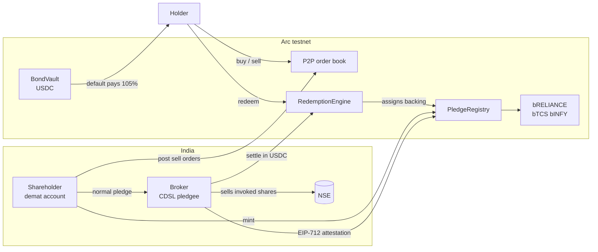

# Bull Street

**Pledge-backed tokens for Indian equities, traded peer to peer, settled in USDC on Arc.**

Shareholders pledge shares they already own to a bonded broker through CDSL, mint one token per pledged share at any hour, and sell them on Bull Street's peer-to-peer order book. Any holder can redeem for USDC: the broker sells the pledged shares on NSE, the owner pays to keep them, or the broker's USDC bond pays 105%. Every payout is priced at the first NSE close after the request, so nobody can redeem at a stale price after news breaks while the market is closed.

> Stock tokens that don't freeze when the market does: backed by shares that are already locked, minted by the people who own them.

- **Chain:** Arc testnet (5042002). USDC for settlement, bonds, fees and gas.
- **Identity:** World ID Proof of Human, one person one role, verified on the server and registered on-chain.
- **Trading:** an on-chain limit order book. People post their own prices; there is no AMM and no pool.

---

## Contents
1. [The problem](#the-problem)
2. [How it works](#how-it-works)
3. [Why USDC settlement](#why-usdc-settlement)
4. [World ID: the trust moment](#world-id-the-trust-moment)
5. [Architecture](#architecture)
6. [Deployed on Arc testnet](#deployed-on-arc-testnet)
7. [Run it](#run-it)
8. [What is real and what is simulated](#what-is-real-and-what-is-simulated)
9. [Limitations and open risks](#limitations-and-open-risks)
10. [Roadmap](#roadmap)
11. [Repository layout](#repository-layout)

---

## The problem

Tokenized stocks today follow the issuer model: an authorised participant buys the real share, a custodian holds it and the issuer mints a token. Every new token needs a share bought at that moment, so **supply freezes whenever the underlying market is closed**. On 30-31 August 2026 a tokenized HIMS traded at $61.15 against a Friday close of $28.84 (+112%) because the mint window was shut for the weekend; the premium collapsed from 93% to 12% within twelve minutes of minting reopening ([DeFi Prime](https://defiprime.com/tokenized-stock-float-squeeze)).

For Indian equities the gap is larger: NSE trades 09:15-15:30 IST on weekdays, about 19% of the week, and buying Indian shares from abroad is hard.

**Our insight:** if the shares are already locked before minting, minting needs no open market. India's depository pledge does exactly that: shares stay in the owner's demat account, pledged to a pledgee who can invoke them (in part) without the owner's action ([CDSL DP Operating Instructions, ch. 8](https://www.cdslindia.com/downloads/DP/currentDPs/DP-Operating-Instructions-Chapter-as-on-March-31-2025.pdf)).

## How it works



1. **Pledge.** The minter opens a pledge on-chain to a broker in the right size tier, then pledges the shares at CDSL: from a connected account, or themselves in CDSL Easiest with the values we compute (guided mode). The broker sees the pledge in its own CDSL account and signs an EIP-712 attestation.
2. **Mint, any hour.** One token per pledged share, against the broker's attestation and the latest NSE close. Fee 0.10%, half to the broker.
3. **Trade peer to peer.** Makers post limit orders with escrow; takers fill them at the maker's price in one atomic transaction. Orders expire at the next NSE open by default. Taker fee 0.10%.
4. **Redeem.** The holder's tokens are escrowed and assigned to backing through a five-level queue: reserve, then pledges of draining or defaulted brokers, volunteers, at-risk pledges, then everything else. Small requests are batched per session.
5. **Get paid at the next close.** Each assignment is priced at the close of the first session after the request:
   - **Cure:** before the cure deadline (next open + 1 h, the "reasonable notice" SEBI's 2026 pledge framework asks for), the minter can pay and keep the shares.
   - **Settle:** otherwise the broker invokes and sells the shares and pays at least 99% of that close.
   - **Default:** if the broker misses the hard deadline (three sessions), anyone can claim 105% of the close from its bond.
   - **Reserve:** backing moved into the reserve (from stale or short pledges) pays at the same close.

**Backing invariant:** for every stock, tokens in existence = Σ minted against live pledges + reserve units + unbacked units, where unbacked is any loss a bond could not cover, shown publicly. It holds after every mint, burn, trade and redemption (fuzz-tested).

**Brokers** are tiered (single-pledge caps), post a USDC bond of 110% of everything pledged to them (125% over long closures), and drain automatically if their health stays below 1.0 for a day. A broker that stops re-attesting has its free backing moved into the reserve, paid from its bond.

## Why USDC settlement

The token holder is anywhere in the world; the shares are in India. USDC is the neutral unit both sides can settle in: brokers post bonds in it, holders are paid in it, and every guarantee (bond requirement, 105% default payout, 0.99 settlement floor) is a contract check on a USDC amount. On Arc, USDC is also the gas token, so a holder needs one asset for everything, and Circle's passkey smart accounts let them do it without a seed phrase.

## World ID: the trust moment

**The event that needs trust:** taking a minter or broker role. A pledge is only meaningful if the minter and the broker holding the shares are different people; one person controlling both could fake a pledge.

**Minimum sufficient credential: Proof of Human.** It gives a unique, anonymous per-app identifier and nothing else. Selfie Check is probabilistic where other people's money depends on independence; passport credentials would collect name and nationality we do not need. Holders need no verification.

**Flow:** the API signs an RP request → IDKit in the browser → the API verifies the proof with the Developer Portal, checks the signal binds the wallet and role, and checks the person holds no role yet → it signs an EIP-712 `RoleAttestation` → the wallet calls `RoleRegistry.register`, which records the role and burns the nullifier on-chain.

**Alternative paths shown in the app:** the same person trying to take the second role is rejected ("You already hold a Bull Street role"); a cancelled verification shares nothing and can be restarted; a wallet with the other role is told to switch wallets. See [WORLD_DEBRIEF.md](WORLD_DEBRIEF.md).

## Architecture

| Layer | What | Where |
|---|---|---|
| Contracts | 14 Solidity contracts: `Directory`, `Params`, `SessionClock` and `PriceOracle` (2-of-3 signed), `Compliance`, `RoleRegistry`, `AssetFactory`/`StockToken`, `BondVault`, `BrokerRegistry`, `LevelBook`, `PledgeRegistry`, `RedemptionEngine`, `BullStreetExchange` | `contracts/` |
| API | Hono service: World ID verification, CDSL depository (connected and guided), pledge and allocation planners, market snapshot, notices, activity | `services/api` |
| Workers | Oracle (Twelve Data, Yahoo fallback; USD/INR median; 2-of-3 signing; session calendar), event indexer and notifier, broker agents (attest, invoke, settle, release, re-attest), keeper (batches, cures, defaults, levels, expiries) | `services/workers` |
| Shared | ABIs, EIP-712 types, calendars, depository ledger, SQLite store | `services/shared` |
| App | Next.js: landing, Markets, Trade (order book), Mint, Broker, Redeem, Ops, Get started | `app/` |

### System design

Users sign every money-moving transaction from their own wallet straight to the contracts. The off-chain host reads the chain, verifies World ID, plays the CDSL depository and runs the robots that post sessions and prices, attest pledges, settle redemptions and do upkeep. API and workers share one SQLite file, so they run on the same machine.

```mermaid
flowchart TB
  %% ---------------- users ----------------
  subgraph USERS["Users"]
    direction LR
    MIN["Minter<br/>shareholder, World ID"]
    BRK["Broker<br/>CDSL pledgee, World ID"]
    TRD["Trader / holder<br/>no sign-up"]
    OPS["Operator<br/>contract owner"]
  end

  %% ---------------- browser ----------------
  subgraph BROWSER["Browser: Next.js app (app/)"]
    direction LR
    PAGES["Pages<br/>/ · /markets · /trade · /mint<br/>/broker · /redeem · /onboard · /ops"]
    WAL["Wallet layer (wagmi)<br/>browser wallet · Circle passkey<br/>smart account · local accounts"]
    IDK["IDKit 4<br/>World ID Proof of Human"]
  end

  %% ---------------- off-chain host ----------------
  subgraph HOST["Off-chain host (services/)"]
    direction TB
    subgraph API["API: Hono, port 8790"]
      direction LR
      R_SNAP["GET /snapshot<br/>chunked chain reads"]
      R_WORLD["/world/rp-context<br/>/world/verify<br/>/world/dev (local only)"]
      R_DEP["/dep/*<br/>simulated CDSL:<br/>accounts, pledges, PSN,<br/>signed pledgee actions"]
      R_PLAN["/plan/pledge<br/>/plan/allocation"]
      R_FEED["/notices · /activity<br/>/deployment · /health"]
    end
    subgraph WORKERS["Workers: one Node process"]
      direction LR
      W_ORA["Oracle · 15 s<br/>24 sessions ahead,<br/>closes signed 2 of 3"]
      W_IDX["Indexer · 4 s<br/>events → SQLite,<br/>in-app notices"]
      W_BRK["Broker agents · 15 s<br/>attest · invoke+sell ·<br/>settle · release · re-attest"]
      W_KEEP["Keeper · 30 s<br/>CDSL processing, batches,<br/>cures, claims, defaults,<br/>health, stale, expiries"]
    end
    DB[("SQLite (WAL)<br/>dep_accounts · dep_pledges · events<br/>notices · world_roles · kv")]
    KEYS{{"Hot keys from .env<br/>oracle ×3 · keeper · broker desks<br/>World attestor"}}
  end

  %% ---------------- external ----------------
  subgraph EXT["External services"]
    direction LR
    WORLD["World Developer Portal<br/>proof verification"]
    PX["Twelve Data → Yahoo fallback<br/>NSE closes"]
    FX["Frankfurter · open.er-api · Yahoo<br/>USD/INR median"]
  end

  %% ---------------- chain ----------------
  subgraph ARC["Arc testnet 5042002 · USDC 0x3600…0000 is money and gas"]
    direction TB
    DIR["Directory<br/>address book, cached by each contract"]
    subgraph CORE["Identity, time and rules"]
      direction LR
      RR["RoleRegistry<br/>one nullifier, one role"]
      SC["SessionClock<br/>sessions + deadlines"]
      PO["PriceOracle<br/>one close per session"]
      CO["Compliance<br/>pauses · freeze · denylist"]
      PAR["Params<br/>fees · caps · timings"]
    end
    subgraph LEDGER["Pledges and brokers"]
      direction LR
      PR["PledgeRegistry<br/>q ≥ m ≥ a per pledge<br/>open · attest · mint · burn<br/>reattest · release · migrate"]
      BR["BrokerRegistry<br/>tiers · exposure · health"]
      BV["BondVault<br/>USDC bonds"]
      LB["LevelBook<br/>queue levels L1-L4"]
    end
    subgraph MONEY["Redemption and trading"]
      direction LR
      RE["RedemptionEngine<br/>tickets · L0-L4 dispatcher · batches<br/>cure · settle · default · reserve"]
      EX["BullStreetExchange<br/>escrowed limit orders"]
    end
    subgraph TOKENS["Assets"]
      direction LR
      AF["AssetFactory"]
      TK["StockTokens<br/>bRELIANCE · bTCS · bINFY"]
    end
  end

  %% ---------------- user ↔ app ----------------
  MIN & BRK & TRD & OPS --> PAGES
  PAGES --> IDK
  PAGES -->|"reads every few seconds"| R_SNAP
  PAGES -->|"plans, CDSL actions, feed"| R_DEP & R_PLAN & R_FEED
  IDK -->|"proof"| R_WORLD
  PAGES --> WAL

  %% ---------------- wallet → contracts (user-signed) ----------------
  WAL -->|"register(attestation)"| RR
  WAL -->|"openPledge · mint · burn · cure<br/>requestRelease · migrate"| PR
  WAL -->|"join · setDelegate · drain · exit"| BR
  WAL -->|"deposit / withdraw bond"| BV
  WAL -->|"trade · cancel"| EX
  WAL -->|"requestRedemption · cure · claims"| RE
  WAL -->|"owner: params, pauses,<br/>corporate actions"| PAR & CO & AF

  %% ---------------- API ----------------
  R_WORLD -->|"verify"| WORLD
  R_WORLD -->|"signs RoleAttestation<br/>(World attestor key)"| KEYS
  R_SNAP -->|"eth_call"| ARC
  R_DEP & R_FEED & R_WORLD <--> DB

  %% ---------------- workers ----------------
  W_ORA --> PX & FX
  W_ORA -->|"postSessions (2 of 3)"| SC
  W_ORA -->|"postBatch closes (2 of 3)"| PO
  W_IDX -->|"getLogs"| ARC
  W_IDX --> DB
  W_BRK <-->|"CDSL records,<br/>indexed allocations"| DB
  W_BRK -->|"attestPledge · reattest<br/>confirmRelease (EIP-712)"| PR
  W_BRK -->|"settle(SaleReport)"| RE
  W_KEEP <-->|"CDSL auto-accept,<br/>15-day reject"| DB
  W_KEEP -->|"processBatch · continueAllocation<br/>finalizeCure · claimReserve<br/>claimDefault"| RE
  W_KEEP -->|"slashStale · rejectExpired"| PR
  W_KEEP -->|"poke · sync · requeue"| BR & LB
  W_KEEP -->|"reclaim expired"| EX
  WORKERS -.-> KEYS

  %% ---------------- contract ↔ contract ----------------
  DIR -.-> CORE & LEDGER & MONEY & TOKENS
  AF -->|"creates"| TK
  TK -->|"check on every transfer"| CO
  PR -->|"mint / burnFrom"| TK
  PR -->|"add/sub exposure,<br/>mark draining/defaulted"| BR
  PR -->|"payFromBond (slash, penalty)"| BV
  PR -->|"addReserve"| RE
  PR -->|"level changes"| LB
  PR -->|"freshClose"| PO
  RE -->|"onAllocate · onCure · onSettle<br/>onDefault · writeOff"| PR
  RE -->|"payFromBond (default 105%)"| BV
  RE -->|"statusOf · markDefaulted"| BR
  RE -->|"burnFrom"| TK
  RE -->|"refSession · deadlines"| SC
  RE -->|"closeAt(refSession)"| PO
  RE -->|"pick backing"| LB
  BV -->|"onBondChanged"| BR
  BR -->|"price exposure"| PO
  EX -->|"paused?"| CO
  EX -->|"expiry = next open"| SC
  RR -.->|"role checks"| PR & BR
```



How to read it: solid arrows are calls or transactions, dotted arrows are lookups. Every arrow out of **Wallet** is signed by a user; every arrow out of **Workers** is signed by a service key from `.env`. If the workers stop, no new sessions or closes are posted, so minting, cures, settlements and payouts wait; trading and cancelling keep working.

Detailed design: [docs/CONTEXT.md](docs/CONTEXT.md) (product and research), [docs/IMPLEMENTATION-PLAN.md](docs/IMPLEMENTATION-PLAN.md) (specification as built), [docs/architecture.md](docs/architecture.md) (diagrams), [docs/decisions.md](docs/decisions.md).

## Deployed on Arc testnet

Chain 5042002 · explorer [testnet.arcscan.app](https://testnet.arcscan.app) · USDC `0x3600000000000000000000000000000000000000` · compressed session calendar.

| Contract | Address |
|---|---|
| Directory | `0xE0284C571bb6CB49a841a9429aCAbfB6CAC47234` |
| PledgeRegistry | `0xb5f82a5368da390Ef0939f14A95c69fd24D646A0` |
| RedemptionEngine | `0xE167Ba57F2F49A3df397eABfbd4774f3B75cb0AB` |
| BullStreetExchange | `0x78a00989e87f507079B180CE149693f22DAF92DC` |
| BrokerRegistry | `0xFfFcCe1bac305E0B65eD53cEb9c2235cf030e82c` |
| BondVault | `0x1D91292c8108b89a563a3aEE3BECa490A0314241` |
| LevelBook | `0x7E52C701A1382193c2AD3105fc1519e9519F8b8f` |
| RoleRegistry | `0x2bAeEdcE4600C3aAB3c054297E9aF741F42FAe1A` |
| SessionClock | `0xce4132B01eC91c59fdB40539CA2419C7C807C27E` |
| PriceOracle | `0xf60e56e4eef8297A9982A512E44280FE0170057B` |
| AssetFactory | `0x1E2AF5591F008EB82b277166f8831414f57d2468` |
| Compliance | `0x5100032564Fde41861754370Cbb7C70D4291471d` |
| Params | `0xC1aB467f260bf64915693D62e4112524DC0999a0` |
| bRELIANCE / bTCS / bINFY | `0x7C0b9637789a27C53eE7DE72B6A25B094Ce6460E` / `0x69678Af651e5fC4109b9AF61D0389829234CC9F9` / `0x42362Fb8e3D604efDB7184A8ebd61d523940ee20` |

All addresses: [deploy/5042002/addresses.json](deploy/5042002/addresses.json).

Bull Street tokens are standard ERC-20s; any venue can list them. For example, Uniswap v4 is live on Arc testnet (PoolManager `0x8366a39CC670B4001A1121B8F6A443A643e40951`, PositionManager `0x6049c9a0e26405C0985f9E3685C87d0aE917f82B`, Universal Router `0x4fcA4a51Ab4F23A7447b3284fBd7D73289A89Fb1`, Permit2 `0x000000000022D473030F116dDEE9F6B43aC78BA3`). We build no Uniswap integration.

## Run it

Requirements: Node 20+, pnpm 10, Foundry.

```bash
pnpm install
cp .env.example .env            # fill in keys (see below)
pnpm build:contracts && pnpm gen
pnpm test:contracts             # 54 tests: unit, scenarios, fuzzed invariants
```

**Local chain (everything in one go):**
```bash
pnpm chain                                         # terminal 1: anvil
CHAIN_ID=31337 RPC_URL=http://127.0.0.1:8545 pnpm deploy:local
CHAIN_ID=31337 RPC_URL=http://127.0.0.1:8545 pnpm seed
CHAIN_ID=31337 RPC_URL=http://127.0.0.1:8545 pnpm e2e     # full lifecycle, fast-forwarding time
CHAIN_ID=31337 RPC_URL=http://127.0.0.1:8545 pnpm api     # terminal 2
CHAIN_ID=31337 RPC_URL=http://127.0.0.1:8545 pnpm workers # terminal 3
pnpm dev                                           # terminal 4: http://localhost:3000
```
On a local chain the wallet menu offers the seeded accounts (minters, brokers, holders), and World ID can be replaced by a handle.

**Arc testnet:**
```bash
pnpm deploy:arc   # needs DEPLOYER_PRIVATE_KEY with test USDC (faucet.circle.com)
pnpm seed         # brokers, minters, pledges and orders (scales to the deployment's tier caps)
pnpm api && pnpm workers && pnpm dev
```

**Environment** (`.env`, see `.env.example`): `DEPLOYER_PRIVATE_KEY`, `DEMO_MNEMONIC` (oracle signers, keeper, broker agents, seeded accounts), `WORLD_ATTESTOR_PRIVATE_KEY`, World ID app and RP keys, `TWELVEDATA_API_KEY`, Circle Modular Wallets client key and URL. The app reads `NEXT_PUBLIC_*` values from `app/.env.local`.

## What is real and what is simulated

| | Status |
|---|---|
| Contracts, backing, bonds, queue, payouts, order book | Real, on Arc testnet |
| World ID Proof of Human, server verification, on-chain registration | Real (staging environment) |
| NSE prices and USD/INR | Real market data (Twelve Data / Yahoo; Frankfurter, open.er-api) |
| Passkey wallets | Circle Modular Wallets on Arc testnet |
| CDSL depository | Simulated ledger that follows CDSL normal-pledge rules; guided mode walks a real owner through CDSL Easiest, and the broker confirms against its own account |
| Brokers' NSE sales | Simulated by the broker agents at the session close (±0.3%) |
| Calendar | Compressed sessions (10 minutes open, 20 closed, 80-minute "weekend") so the lifecycle plays out in minutes; the same contracts run the real NSE calendar |
| Oracle | Three signer keys run by one operator (2-of-3 threshold enforced on-chain) |
| USDC | Arc testnet USDC |

## Limitations and open risks

- **The token is a claim, not a share.** It pays out in USDC; holders get no voting rights or dividends (price-return). Corporate actions adjust a shares-per-token multiplier.
- **Collusion.** World ID stops one person holding both roles, but two people could fake a pledge. Losses are capped by the broker's bond and shown as unbacked if it runs out.
- **Pledge proof is the broker's signature**, re-attested regularly; an unexplained drop defaults the broker and moves backing into the reserve.
- **Redemption takes sessions.** Holders wait for the next session's close and T+1 settlement; that is the price of not letting traders profit from news while NSE is closed.
- **Gap risk above the bond.** A large move between the close and settlement can exceed the 10% bond buffer.
- **Rupees to USDC.** Brokers sell in INR and pay in USDC; minters receive USDC. A production rail needs a licensed GIFT City (IFSC) settlement entity and an authorised dealer bank.
- **Regulation.** Securities law (SCRA), foreign exchange (FEMA) and the VDA tax regime apply to a real launch; this is a testnet prototype and not an offer of securities.
- **Oracle trust.** Prices and calendars are signed 2-of-3, but by keys run by one operator here.
- **Depository.** NSDL accounts are not supported; no broker or Account Aggregator API can create a pledge today, so production needs the depositories' LAS rails.

## Roadmap

**Liquidity.** Every token can be redeemed for about the stock's value, so the order book never has to hold the price up on its own. Minters are the natural sellers: they mint and list exactly when buyers show up, including while NSE is closed. Brokers are natural buyers, since they can buy the shares back on NSE. Next: a market-making programme with brokers paid from taker fees; an off-chain order book with on-chain settlement so posting and cancelling are free; listings on other venues (the tokens are standard ERC-20s). No reward token.

**Production rails.** CDSL LAS / NSDL Digital LAS for real-time pledge creation and callbacks; a GIFT City settlement entity; independent oracle signers; zkEmail proofs of CDSL pledge alerts.

## Repository layout

```
contracts/      Foundry project: src/ (14 contracts), test/ (unit, scenario, invariant), script/Deploy.s.sol
services/shared ABIs, EIP-712 types, calendars, depository ledger, SQLite store, personas
services/api    Hono API (port 8790)
services/workers oracle, indexer and notifier, broker agents, keeper
app/            Next.js app
scripts/        deploy.ts, seed.ts, e2e.ts, oracle-once.ts
deploy/         deployed addresses per chain
docs/           CONTEXT.md, IMPLEMENTATION-PLAN.md, architecture.md, decisions.md
```

License: MIT.
